# Логика климатического контроллера

Актуализировано 30 октября 2026: **office_climate 0.4.41**, политика 0.4.2, интерфейс ha-material3 0.19.9. Номера версий относятся к разным компонентам. HACS-пакет этого репозитория поставляет интерфейс и шаблоны; Python-контроллер устанавливается отдельно. Его наличие нельзя предполагать только по установленной карточке.

Схемы описывают реализацию reconcile-контроллера, а не прежний набор YAML-автоматизаций. Это обзор проверок и переходов, не перечисление каждого выражения в коде. [Каталог условий шаблонов](condition-index.md) охватывает только Jinja-формулы и не является полным каталогом контроллера.

## 1. Один расчёт - согласованный план

Изменение пользовательского намерения, входящий отчёт устройства или плановый тик каждые 60 секунд вызывают перерасчёт. Первое событие ставит расчёт через 0,25 с; последующие события не отодвигают этот срок. Одновременно выполняется один проход, события во время него оставляют следующий проход в очереди. Прототип `TickGate` с пределом 2 с не является планировщиком установленного HA-компонента. Расчёт получает один неизменяемый снимок показаний, возможностей устройств, ручных ограничений, операций в полёте и памяти контроллера.

За один тик вычисляется весь план без команд устройствам. Применение идёт отдельно, последовательными допустимыми шагами. Перед отправкой контроллер заново проверяет актуальность намерения и допустимость шага. Новый отчёт или изменение цели запускает следующий расчёт; готовый устаревший план не исполняется вслепую.

Система использует память: владельцев настроек, ревизии намерений, гистерезис, PI-интеграл, паузу компрессора, незавершённые операции и бюджет остановки. «Один тик» не означает отсутствие состояния между тиками.

## 2. Ручной режим, Авто и Выключено

У каждого параметра свой владелец: пользователь или HA. Ручное значение является ограничением для совместного подбора остальных параметров. Оно не исчезает из расчёта и не меняется из-за автоматического выбора другой настройки. Пресет, затрагивающий несколько полей, допустим только при совместимости со всеми закреплёнными полями.

| Действие | Смысл |
| --- | --- |
| Число на шкале | Сохранить ручное намерение для связанной группы параметров; выполнить после отпускания |
| Авто на шкале | Передать параметр и связанную группу по контракту шкалы контроллеру HA |
| Авто всей карточки | Передать связанные параметры устройства HA |
| Фиксация текущих настроек | Сохранить подтверждённые значения вручную; неизвестное не превращается в ноль |
| Выключено у AC, обогревателя, очистителя или скорости бризера | Сохранить явное Off и запустить ограниченную остановку |
| 5 °C у температуры бризера | Минимальная уставка притока «Без нагрева»; **не выключение вентилятора** |

Авто HA отличается от встроенного Auto устройства. Например, сохранённая скорость очистителя во встроенном Auto не является измеренной скоростью мотора. В Авто шкала показывает доступную текущую настройку, а принадлежность автоматике отображается отдельно.

## 3. Достоверность снимка

Доступность HA-сущности и её обновлённый timestamp не доказывают новый отчёт устройства. Реестр входящих данных проверяет происхождение, эпоху подключения, возраст, диапазон и тип каждого поля. После переподключения прежнее подтверждение не становится новым автоматически. Для разрешённого профилем Zigbee-кэша сохраняется исходное время атрибута: чтение кэша не обнуляет возраст измерения. Неизвестные значения не заменяются нулём.

Недостоверная температура комнаты запрещает новый тепловой запуск, выключает разрешённый автоматике комнатный нагрев/охлаждение и снижает автоматическую уставку притока до 5 °C. Ручные тепловые команды также проходят проверку источника. Вентиляция и очистка используют собственные датчики и явно заданный резервный план.

## 4. CO₂, очистка, шум и усиление

Свежесть задаётся **целевым CO₂: 600-1400 ppm, шаг 50**. Базовая скорость притока ниже цели - 2; при достижении цели и превышении на 200, 400, 600 и 800 ppm запрос последовательно растёт до 7. При снижении используются границы на 50 ppm ниже, чтобы не переключать скорость около порога. Изменение цели сбрасывает прежний гистерезис CO₂. При недостоверном CO₂ применяется резервный запрос 3, а не предположение о чистом воздухе.

Очистка рассчитывается отдельно по PM2.5 и пользовательскому предпочтению. Затем учитываются профиль, тишина, аппаратные пределы и временное усиление. Усиление не отменяет ручной Off и жёсткие ограничения. Это запросы к совместному планировщику, а не безусловные команды моторам.

**Приток не выключается из-за кондиционера.** При охлаждении меняется только принадлежащая HA уставка подогрева притока: 5 °C, со сбросом PI-интеграла. Ручная уставка притока сохраняется. Показание `fan_only` и уставка 5 °C не доказывают физическое обесточивание нагревателя бризера.

## 5. Ошибки и частичная недоступность

Явная ошибка, неизвестная блокировка, неподходящие возможности или недоступность не дают обычный допуск. Независимые исправные устройства продолжают участвовать в расчёте, если неопределённость не создаёт теплового конфликта. Ручной режим не обходит подтверждённую ошибку.

Для AC предусмотрено узкое исключение: отсутствие необязательного отчёта ошибки допускается при полном достоверном снимке текущей сессии и известном отсутствии сохранённой блокировки. Просроченный, некорректный или полученный до текущей эпохи отчёт не считается таким отсутствием. Явная ручная команда имеет отдельную проверку допуска; это не разрешение игнорировать ошибки других устройств.

Снятие блокировки не означает включение. После восстановления заново оценивается последнее намерение; старые команды не воспроизводятся автоматически.

## 6. Температура и взаимодействие приборов

| Устройство | Автоматический расчёт | Ограничения времени |
| --- | --- | --- |
| Кондиционер | Комнатная цель, текущий цикл, собственный датчик, условия начала/завершения охлаждения или нагрева | Защита компрессора 300 с; фоновая коррекция уставки не чаще 600 с. Новая цель комнаты применяется без ожидания фонового интервала |
| Электрический обогреватель | Старт при комнате ≤ цель - 0,4 °C; работа до комнаты ≥ цель + 0,1 °C; аппаратная уставка с поправкой собственного датчика ±3 °C в пределах 18-28 °C | **Нет фиксированной паузы повторного включения**; фоновая коррекция не чаще 600 с. Новая цель комнаты и начало цикла не ждут этого интервала |
| Подогрев притока | PI-регулятор комнатной ошибки в диапазоне 5-25 °C, только при разрешении соответствующих параметров | Шаг не чаще 60 с; ограничение изменения на 2 °C |

Для AC сохранены порог начала 0,7 °C, противоположный защитный порог 0,5 °C и обычное завершение с допуском 0,1 °C после 300 с. Совместный план уважает весь интервал удержания этого цикла: общий допуск ±0,2 °C не должен преждевременно остановить AC. Ручной конфликт, явный Off и проверки безопасности имеют приоритет над удержанием. Готовность и предел подогрева притока не являются дополнительным условием запуска обогрева AC; прежняя подпись об этой зависимости была ошибочной. Ручной выбор AC использует свою классификацию относительно температуры комнаты и нормализацию аппаратной уставки; это отдельный путь, а не эти автоматические пороги.

Переход из нагрева/охлаждения в вентиляцию отправляет непосредственно `fan_only`. Из вентиляции в нагрев/охлаждение не нужна промежуточная команда Off, если защита компрессора уже выдержана. Переходы только между Off и вентиляцией не перезапускают защитный таймер. Отсчёт ведётся от полученных переходов компрессорного режима или остановки питания в таком режиме; после запуска HA остаётся консервативная пауза 300 с. Переход между противоположными тепловыми режимами по-прежнему требует подтверждённого Off и защитного интервала.

Комнатный обогреватель и охлаждающий AC не должны противодействовать друг другу. При переключении требуется подтверждённая остановка конфликтующего комнатного источника; если он закреплён вручную, противоречащий запуск блокируется. Бризер не входит в этот взаимный запрет комнатных источников.

В 0.4.40 удалена введённая контроллером пауза Xiaomi 120 с, включая такую паузу после запуска HA. Это не отключение штатной защиты прибора. Гистерезис, ошибки, достоверность измерений, ограничения операций и конфликт с охлаждением сохранены. В [руководстве Mi Smart Space Heater S](https://cdn.azams0.fds.api.mi-img.com/xiaomi-b2c-i18n-upload/User-Guide-Upload-mi.com/Personal_Care/27574-Mi-Smart-Space-Heater-S-UserGuide-EU.pdf) обычное включение/выключение описано без требования двухминутного ожидания.

## 7. От плана до подтверждения

До отправки сохраняется операция с идентификатором и ревизией намерения. Проверяются её актуальность, разрешённые эффекты, состояние транспорта и конфликты. Изменение цели отменяет устаревший локальный шаг. Подтверждением служат подходящие входящие данные устройства в рамках действующего протокола, а не успешный ответ сервиса HA или оптимистическое изменение карточки.

Тайм-аут означает неопределённый результат. Он не доказывает, что команда не исполнится позже. Обычная попытка для неизменившейся цели ограничена; минутные тики не должны заново выдавать ей бюджет. Показания устройства также не являются независимым измерением воздушного потока или фактической тепловой мощности.

## 8. Память и плавность регулирования

PI-настройки: Kp=4, Ki=0,15, зона нечувствительности ±0,2 °C, интеграл -20…5, максимальный учитываемый интервал 5 минут. Расчёт чистый: повторная проверка команды не накапливает интеграл вторично. Новая память сохраняется с принятым планом. Ручная фиксация температуры и Off исключают накопление неиспользуемого управления.

Новая аппаратная уставка AC или обогревателя сохраняется до подтверждения, пока её комнатная цель и владелец остаются актуальными. Поэтому сохранение памяти перед повторной проверкой команды не теряет ещё не отправленную уставку. Ручной владелец, остановка или новая комнатная цель отменяют прежнюю ожидающую уставку.

Гистерезис CO₂ и температуры отделён от временных ограничений команд. Перемещение ползунка показывает предварительный выбор; команда возникает после отпускания. Анимация и надпись «Выполняется» не служат доказательством исполнения.

## 9. Явная остановка и позднее включение

Off повышает ревизию намерения, прекращает локальные повторы и запускает адресную остановку. Контроллер проверяет входящий Off и продолжает учитывать возможную позднюю команду. При позднем On повторяет Off в пределах сохранённого бюджета: до 3 попыток, интервал 30 с. Бюджет не сбрасывается новым тиком или перезапуском.

После исчерпания бюджета или неподтверждённой остановки сохраняются неопределённость и запрет конфликтующего теплового запуска. Новое явное намерение может снять активную остановку через проверяемый переход. Это практическая защита от поздних команд; протокол не позволяет обещать, что уже отправленная дейтаграмма никогда не исполнится.

## Источники и проверка схем

Соответствие модулям backend, проверенные границы и изменения версий: [архитектура контроллера](controller-architecture.md). Исходники схем - [Mermaid](diagrams/); SVG сохранены рядом для просмотра на GitHub. [Команда воспроизведения](tools/README.md#controller-diagrams) не требует соединения с домашним HA.
