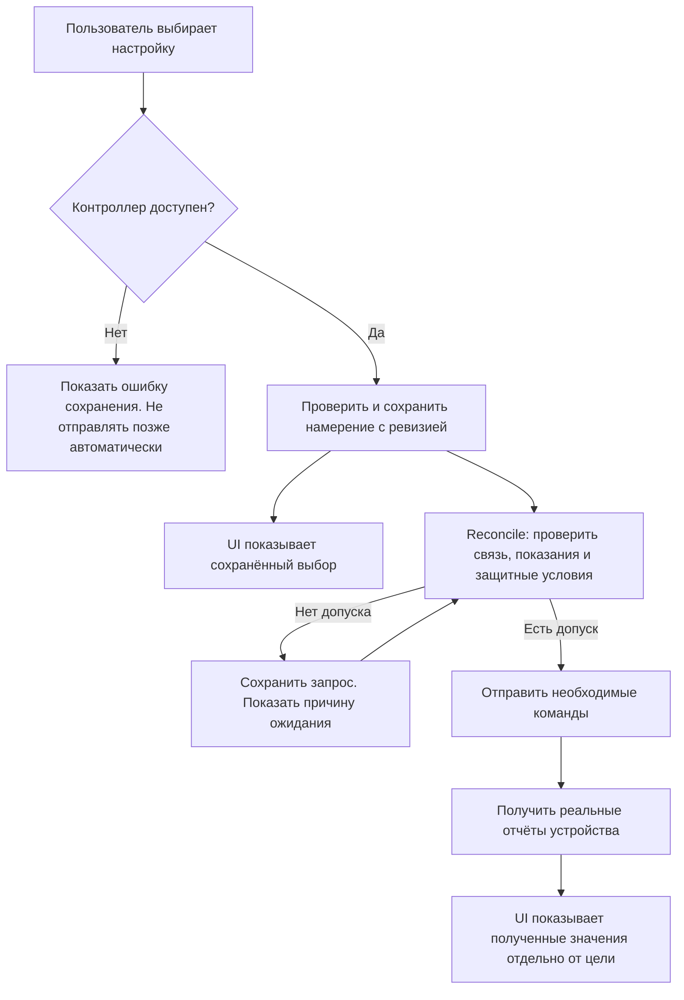
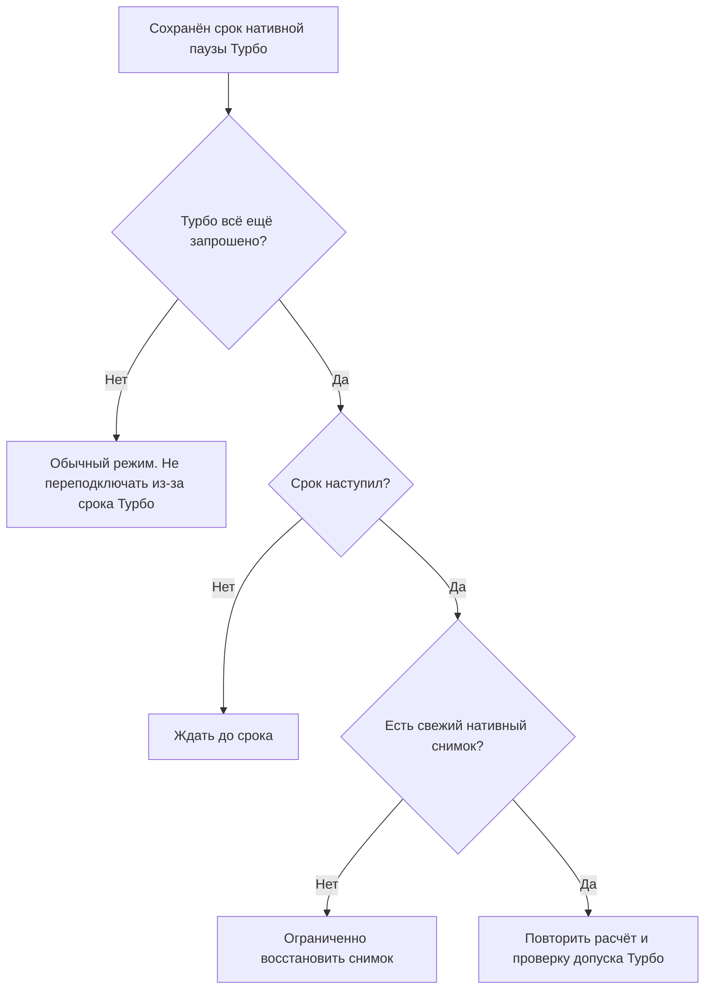

# Интерфейс, выбранные настройки и связь с прибором

UI 0.19.11 с office_climate 0.4.45 разделяет три состояния: сохранённый выбор пользователя, полученные показания и доступность связи. Они не заменяют друг друга.

При потере связи карточка сохраняет шкалы, меню и известные настройки. Возможность редактирования требует живого контроллера, известных разрешений и проверенных диапазонов прибора. Без этих данных UI не выдумывает диапазон или текущую температуру. Зафиксировать неизвестное текущее состояние как ручное нельзя. Ручная температура кондиционера дополнительно требует свежего комнатного измерения.

`control_contract: durable-intent-v1`, `desired` и `intent_revision` - проекция сохранённого намерения. `temperature`, `fan_mode`, `preset_mode` и `source_qualified` относятся к полученным данным. Даже совпадение цели с кэшем или успешный ответ API не доказывает выполнение. При недоступном HA интерфейс не накапливает команды для неожиданной отправки после подключения.

Полностью автономная работа сайта при недоступности самого сервера HA потребовала бы отдельного приложения и локального кэша. Текущее изменение разделяет состояние карточки и прибора внутри существующего дашборда, не создавая второй контур управления.

## Восстановление Турбо

До 0.4.45 условие обслуживания соединения не проверяло действующий запрос Турбо. Истёкшая пауза сохранялась после перехода в обычный режим и вызывала ненужные переподключения при возрасте MODE более 120 секунд. Теперь этот путь действует только при актуальном запросе Турбо; обычное восстановление реально потерянной связи и защита Off сохранены.
