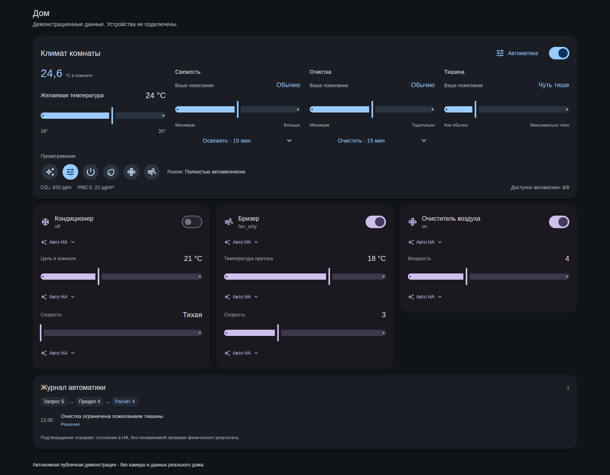
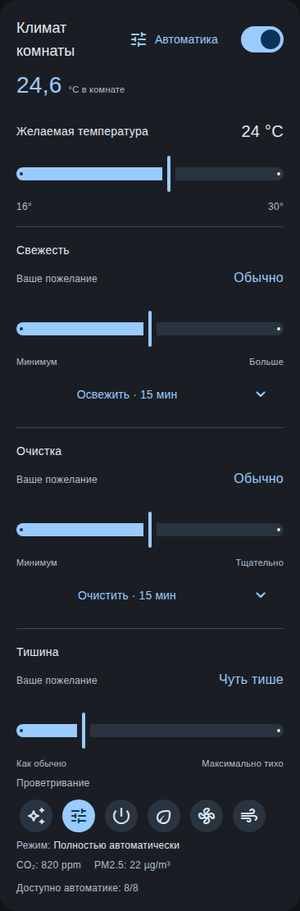
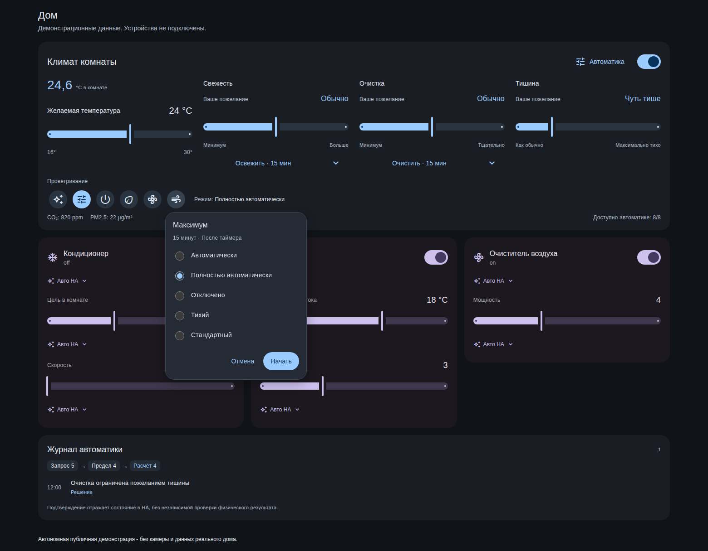
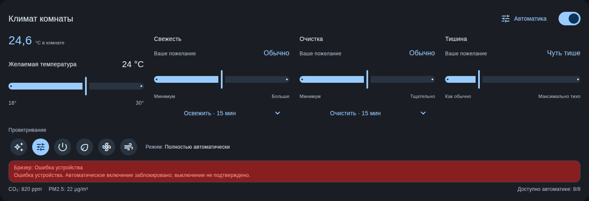

# Скриншоты

Все изображения получены из автономного стенда с **синтетическими данными**. Это не снимки реального дома. Здесь нет личных имён, реальных названий комнат, адресов, учётной записи, камеры и персональных сигналов. Значения датчиков и запись журнала демонстрационные.

## Большой экран

Четыре независимых пожелания, компактные режимы, отдельные параметры устройств и журнал решений.

## Телефон

Пожелания располагаются вертикально; режимы остаются круглыми кнопками с доступными названиями.

## Возврат после Maximum

Открытие меню не запускает режим. Следующий профиль выбирается до подтверждения.

## Пример ошибки устройства

Искусственно заданное состояние стенда показывает ошибку и неподтверждённое выключение. Реальные неисправности для создания иллюстрации не вызывались.

[Блок-схемы всех условий](automation-flow.md) | [Воспроизведение](tools/README.md) | [Проверка файлов и отсутствия внешних запросов](images/privacy-report.json)
